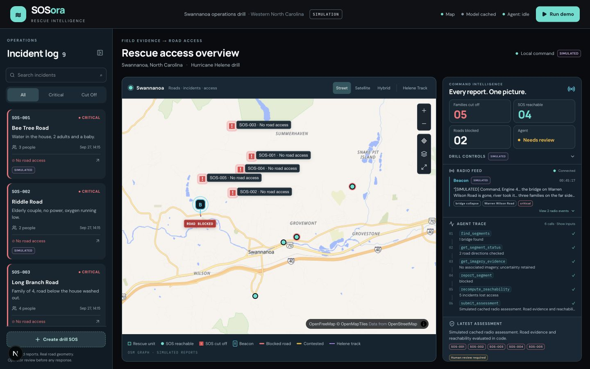

# SOSora

**Hosted demo:** deployment prepared, public site not published. Hugging Face
returned HTTP 402 for free CPU Docker hosting (PRO account required); Vercel login
is verified and the [Vercel project](https://vercel.com/peanutz28s-projects/sosora-command-demo)
is created and linked to `frontend/`. Backend target: `https://peanutz28-sosora-command-demo.hf.space`
**(not live)**. Frontend URL: **not allocated**. See the tested package, local
screenshots and exact human-run commands in [docs/HOSTED_DEMO.md](docs/HOSTED_DEMO.md).

**The rescue map that keeps working when the towers and the roads don't.**

NVIDIA x Red Hat Small Models Hackathon (Raleigh, Oct 2026). Track: **tool-calling**.
Built by two sisters in one weekend.

> New contributor or AI agent? Read [`docs/CONTEXT.md`](docs/CONTEXT.md) first. It is the
> living source of truth for status, decisions and next steps.

## The problem
In a hurricane, two networks fail at the same time.

- **Phones go down**, so rescuers lose track of *who* needs help. During Hurricane Helene,
  about 74% of cell sites in North Carolina's 21-county disaster area were out (FCC, Sep 28 2024).
- **Roads go down**, so rescuers lose *how* to reach them. By Nov 1 2024, NCDOT had identified
  more than 8,100 damage sites on roads, bridges and culverts in western North Carolina.

North Carolina's own Helene after-action review found that communications broke down and
operational information wasn't shared, and recommended that local teams be able to operate
**without communications for up to 72 hours**. Today, a road report heard on the radio lives
on a whiteboard. Crews find out a bridge is gone by driving to it.

## What SOSora does
One field message changes the whole picture, in seconds, with no internet.

1. A **SOSora Beacon** (Raspberry Pi + mic + water-level sensor at a crossing) or a responder
   radio reports: *"the bridge on Warren Wilson Road is gone, three families on the far side."*
2. **Nemotron 3.5 Lightning** turns the garbled message into a structured report.
3. A **Lightning tool-calling agent** finds the real bridge on the OpenStreetMap road graph,
   checks its status and evidence, records the report, and recomputes who can still be reached.
4. The **command dashboard** shows the bridge go red and which families just lost their way out.

When something breaks, it says so instead of guessing: two bridges match -> it asks the
operator; a tool fails -> it reports "unknown"; a single "it's open" report -> the road stays
avoided until verified.

## Architecture
```
 SOSora Beacon (Pi, mic, water gauge) ─┐
 Responder radio (voice) ──────────────┼─> SOSora Command (one GPU box, mobile command vehicle, offline)
 SOSora SOS app (offline queue) ───────┘     speech to text -> Lightning parse -> Lightning agent (vLLM)
                                              -> tools: find road, status, imagery, report (trust rule), reachability
                                              -> offline OSM/NCDOT map -> command dashboard
 NeMo Gym: measures the agent on failure scenarios     Hub (when a link returns): DOT closures, aerial imagery + vision model
```

| Component | Code | Technology |
|---|---|---|
| Radio / Beacon intake, hero flow | `backend/app/radio_api.py` | FastAPI |
| Tool-calling agent + trust rule | `backend/app/agent.py` | Nemotron 3.5 Lightning, OpenAI-compatible tool calls |
| Radio parser | `ml/inference/radio.py` | Nemotron 3.5 Lightning, JSON mode, grounding check |
| Speech to text hook | `backend/app/asr.py` | NVIDIA ASR via OpenAI-compatible endpoint |
| Routing + reachability | `backend/app/routing.py` | NetworkX on the real OSM graph (43,590 nodes / 86,254 edges) |
| Agent evaluation | `ml/nemo_gym/` | NVIDIA NeMo Gym resource server + verifier |
| Aerial flood evidence | `ml/vision/` | Fine-tuned NVIDIA SegFormer-B0 |
| Dashboard | `frontend/` | Next.js |
| Beacon | `beacon/` | Raspberry Pi, USB mic, HC-SR04 |

## Why these technologies
- **Nemotron 3.5 Lightning** is the only generative LLM (hackathon cap: 33B total). It is fast
  enough for an agent loop and strong at structured tool calls.
- **vLLM on one NVIDIA H100** serves Lightning through the configured `redhat_vllm` adapter.
  The verified deployment used upstream vLLM, not a verified Red Hat-distributed image.
  [Serving evidence](docs/VLLM_RESULTS.md).
- **NeMo Gym** gives fixed tasks and a verifier, so we can measure whether the agent improves.
- **Small models** are the point: the state's own review asks for 72 hours with no comms.

## Results (measured; see evidence folders)

**NeMo Gym, clean Brev vLLM runs:** frozen simulated tasks and policies, using the
pinned tools/verifier. No weights changed and no RL was performed.

| Split | Policy | Pass / requested | Provider errors | Mean recorded request ms |
|---|---|---:|---:|---:|
| validation | baseline | 8/14 | 0 | 427.4 |
| validation | evidence_first | 2/14 | 0 | 532.1 |
| test | baseline | 7/14 | 0 | 403.4 |
| test | evidence_first | 4/14 | 0 | 520.6 |

Baseline outperformed the frozen evidence-first prompt on both splits. These scores
do **not** establish real-world rescue safety or an evidence-first improvement.
The earlier hosted runs had transport failures and are not the headline policy result.
[Full comparison, methodology and caveats](docs/GYM_RESULTS.md).

**Live vLLM speed:** earlier hosted API observations were **24–55 seconds per agent
turn**. On the NVIDIA H100 vLLM deployment, the final five live hero runs all passed:
**mean agent call 0.852 seconds** across 30 calls and **mean hero API run 12.442 seconds**,
including parsing and graph work. Gym request means above use a different task protocol;
these serving configurations are not a controlled hardware-only comparison.
[Hero measurements](docs/VLLM_RESULTS.md#final-hero-measurements) ·
[Earlier hosted observations](docs/briefs/BREV_VLLM_CODEX.md).

- **Vision fine-tune** (SegFormer-B0, 3.7M params), frozen cross-event check on 6 unseen
  Germany flood tiles: F1 0.23 -> 0.47 versus the same model before fine-tuning.
  [`docs/ml/FROZEN_EXTERNAL_EVALUATION.md`](docs/ml/FROZEN_EXTERNAL_EVALUATION.md)
- **Hero scenario** on real Swannanoa roads: the eastern Warren Wilson Road bridge is the only
  crossing in our map area for the neighborhoods north of it; blocking it makes 5 of 9 simulated
  SOS incidents unreachable. Covered by `backend/tests/test_radio_api.py`.

## What is real and what is simulated
Real: OpenStreetMap / NCDOT roads, the routing graph, Nemotron model calls, NeMo Gym evals,
vision evaluation numbers, Helene statistics (sourced). **Simulated and labeled:** SOS
incidents, radio messages, rescue units. SOSora is a hackathon prototype, not a dispatch system.

## Command dashboard screenshots

Jia’s night-operations visual design now runs on the Next.js / MapLibre command dashboard,
with the existing road graph, agent and trust rule. All drill SOS incidents and radio reports
remain labeled **SIMULATED**. In `DEMO_MODE=true`, parsing and the agent plan use cached demo
fixtures; tool execution and reachability run against the real graph.



[1920×1080 hero view](docs/screenshots/ui-hero-1920x1080.png) ·
[Ambiguous bridge review](docs/screenshots/ui-ambiguity-1440x900.png) ·
[1920×1080 bridge review](docs/screenshots/ui-ambiguity-1920x1080.png) ·
[NHC Helene track](docs/screenshots/ui-helene-1920x1080.png) ·
[Incident details](docs/screenshots/ui-incident-1920x1080.png)

Use **Run demo** to seed and submit the Beacon report. The collapsible drill controls also
support **S** seed, **B** Beacon, **R** responder without location, **D** unverified DOT open
claim, and **W** sensor spike. Two matching bridges require an operator to confirm a real
candidate on the map or in the console. The radio feed, tool trace and access counts update
over WebSocket; the interface stays interactive while an assessment runs.

Validation: `node --test frontend/tests/*.test.cjs`, `cd backend && pytest -q`, and
`cd frontend && npm run build`. Saved [UI QA evidence](docs/evidence/ui_merge_2026-10-18/)
covers the Beacon, ambiguity/confirmation, DOT and sensor paths. A production build can run
beside the dev server with `SOSORA_NEXT_DIST_DIR=.next-build npm run build`.

## Run it
```bash
# Backend (DEMO_MODE=true needs no API keys; uses cached parses and a cached agent trace)
cd backend && python -m venv .venv && .venv/bin/pip install -r requirements.txt
DEMO_MODE=true .venv/bin/uvicorn app.main:app --port 8000
# Dashboard
cd frontend && npm install && npm run dev        # http://localhost:3000
# Try the hero flow
curl -X POST localhost:8000/api/radio/demo/seed
curl -X POST localhost:8000/api/radio -H 'content-type: application/json' \
  -d '{"message":"<hero_message from the seed response>","source_type":"beacon","lon":-82.42702,"lat":35.61258}'
```
Live models: set `DEMO_MODE=false` and `NVIDIA_API_KEY` (hosted) or `LLM_BASE_URL` /
`LLM_MODEL` / `LLM_API_KEY` (your vLLM server). ML service: see `docs/ml/` (Python 3.12).

Tests: `cd backend && pytest -q`.

## Repository map
`backend/` app API, agent, radio + beacon endpoints · `ml/` model service, Gym, vision ·
`frontend/` dashboard · `beacon/` Raspberry Pi device · `docs/CONTEXT.md` living context ·
`docs/briefs/` task briefs for each workstream · `contracts/` API contracts ·
`docs/ml/PREVIOUS_README.md` detailed ML notes.

## Operations dashboard and native iOS app
Two additional applications live beside the agent stack. They do not replace `backend/`, `frontend/`, or `ml/`.

| App | Path | What it is |
|---|---|---|
| Operations dashboard | `dashboard/` | FastAPI plus a Leaflet map for Swannanoa. SOS incidents, road reports, access analysis, the Helene best track, and current weather. |
| Native iOS app | `ios-app/` | SwiftUI field app. Residents queue an SOS offline. Operators can review incidents and send a road report. |

The iOS app talks only to the operations dashboard, not to the Next.js app in `frontend/`. Its default base URL is `http://127.0.0.1:3000`, which is also the port in `dashboard/run.py`. Run one of those two servers at a time: the Next.js dashboard in the section above also uses port 3000.

Shared HTTP contract:

- `GET /api/health` and `GET /api/state`
- `POST /api/incidents` with `client_id`, `message`, `people`, `place`, `lat`, `lng`
- `PATCH /api/incidents/{id}` with a status of Received, Acknowledged, Under review, or Resolved
- `GET /api/road-segments` and `POST /api/road-reports`

Road geometry in `dashboard/frontend/roads.geojson`, `dashboard/swannanoa_roads.graphml`, and `dashboard/swannanoa_roads.gpkg` is the Swannanoa OpenStreetMap extract. The NHC Helene track used by the map is `dashboard/frontend/helene-best-track.geojson`.

### Run the operations dashboard
```bash
cd dashboard
python3 -m venv .venv
.venv/bin/pip install -r requirements.txt
.venv/bin/python run.py
```
Open http://127.0.0.1:3000. The resident page is http://127.0.0.1:3000/resident. Tests: `.venv/bin/python -m unittest tests.test_roads tests.test_ops`.

The radio gateway reads `SOSORA_GATEWAY_TOKEN` from the environment. Do not commit that value.

### Run the iOS app
Open `ios-app/SOSora App.xcodeproj` in Xcode, select an iPhone simulator, and run. Start the operations dashboard first. The simulator can reach `127.0.0.1:3000`. A physical iPhone needs the Mac's LAN address in the app's server setting, and the phone and Mac must be on the same network.
