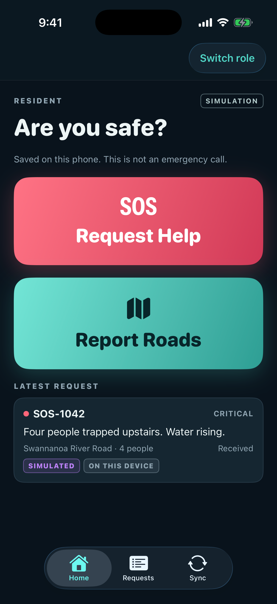
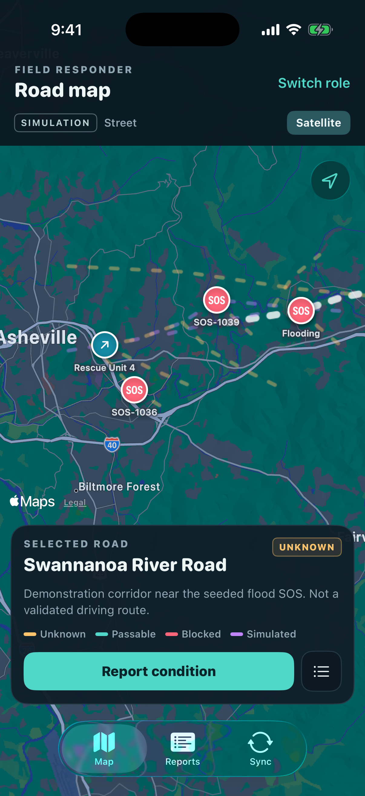
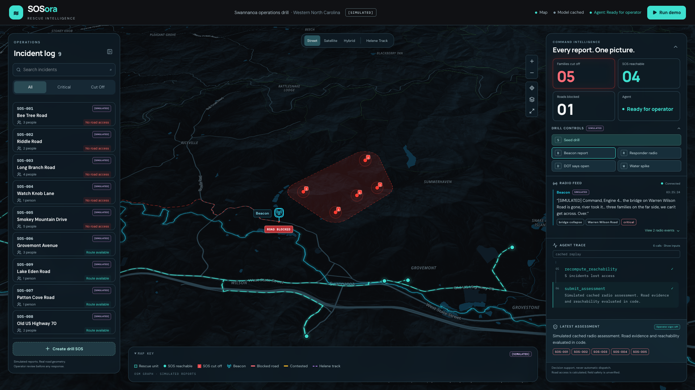

# SOSora

**A Congressional App Challenge project · Disaster reporting that keeps working when cell service doesn’t.**

SOSora is a disaster-response prototype built by two sisters. Its iPhone app lets residents save SOS requests and field responders record road conditions. A local command system combines those reports with road-network data to show which households may have lost access.

**Try the web demo:** [SOSora Command](https://sosora-command-demo.vercel.app) · [Backend API](https://sosora-command-demo.onrender.com) · [Deployment notes](docs/HOSTED_DEMO.md). The hosted version runs a cached demonstration and may take a moment to wake up.

> SOSora is a prototype for decision support. It does not contact 911, dispatch responders, or verify road safety. Sample incidents and reports are simulated.

## Why we built it

During a hurricane, residents can lose phone service at the same time roads and bridges become impassable. People need a way to record requests for help, and responders need to share what they know about roads, even when communications are unreliable.

Hurricane Helene showed the scale of that problem in western North Carolina: the FCC reported that about **74.3% of cell sites were out** in the designated 21-county North Carolina disaster-reporting area in its September 28, 2024 snapshot. By November 1, NCDOT had identified **more than 8,100 damage sites** involving roads, bridges, and culverts. North Carolina’s after-action review recommended preparing local emergency managers to operate without communications for up to **72 hours**. These figures describe a past disaster and a preparedness recommendation, not SOSora’s performance. ([FCC report](https://docs.fcc.gov/public/attachments/DOC-405893A1.pdf) · [NCDOT release](https://www.ncdot.gov/news/press-releases/Pages/2024/2024-11-01-ncdot-relief-efforts-helene-western-nc.aspx) · [North Carolina after-action review](https://www.ncdps.gov/tropical-storm-helene-after-action-review))

## How SOSora works

1. **A resident records an SOS** in the native iPhone app: incident type, location, number of people, and optional details. The request is saved on the phone first and can wait there until the demo server is available.
2. **A field responder records a road observation** from the map. They select a road and mark it passable, blocked, or unknown, with a note, time, and optional photo. Photos stay on the phone; the current API accepts text only.
3. **Command updates the shared picture.** When connected, SOS reports and road-report text can flow into the command system. Its routing tools check the road graph and recompute which simulated SOS locations remain reachable.
4. **People stay in control.** Ambiguous locations are sent for operator review. An unverified field note does not, by itself, prove a road is safe or reopen it.

## Native iPhone app

The SwiftUI app is SOSora’s field interface for residents and responders. It keeps locally saved requests and road reports on the device, shows their sync state, and lets residents review accepted request statuses. The demo’s sample requests are marked **SIMULATED**.

<table>
  <tr>
    <th>Resident · request help or report roads</th>
    <th>Field responder · inspect a selected road</th>
  </tr>
  <tr>
    <td></td>
    <td></td>
  </tr>
  <tr>
    <td><a href="docs/screenshots/mobile-sos-form.png">View the SOS form</a></td>
    <td><a href="docs/screenshots/mobile-road-report.png">View the road report form</a></td>
  </tr>
</table>

Screenshots were captured from an iPhone 17 Pro simulator running iOS 26.5. The map and sample incidents are for demonstration; the displayed road geometry is not a validated driving route.

## Command map

The web command view connects reports to a map and an incident list. This screenshot shows a **simulated** Beacon report, a blocked road, and five simulated SOS locations whose access changed in the drill.



[Idle map](docs/screenshots/cinematic/freeze/idle.png) · [Ambiguous bridge awaiting review](docs/screenshots/cinematic/freeze/ambiguity.png) · [Confirmed bridge assessment](docs/screenshots/cinematic/freeze/confirmed-ready.png) · [Presentation mode](docs/screenshots/cinematic/freeze/presentation.png) · [Helene track view](docs/screenshots/ui-helene-1920x1080.png) · [Incident details](docs/screenshots/ui-incident-1920x1080.png)

## Designed for uncertainty

SOSora uses an AI model to turn radio language into structured candidate reports, but the model does not make the final road decision on its own. Code checks locations and evidence against the road graph, applies trust rules, and leaves ambiguous reports for a person to review. If evidence is missing or a tool fails, the system can report “unknown” instead of presenting a guess as fact.

Aerial imagery analysis is an experiment, not a deployed capability. It did not beat the existing model in the sealed comparison, so it is not used to determine road status. See [vision results and limitations](docs/ml/V3_RESULTS.md).

## What we measured

These results come from saved, simulated evaluations and system benchmarks. They do not establish performance in a real disaster.

| Evaluation | Result | Details |
|---|---|---|
| **NeMo Gym sealed exam** · 42 unseen scenarios × 3 runs | **31%** baseline → **71%** with a rewritten system prompt → **98%** after adding audited argument repair | [Results and methodology](docs/GYM_RESULTS.md) · [Every attempt](docs/gym/index.html) |
| **Ambiguity and unsafe reopening checks** · 30 fresh-seed runs | Correct bridge and affected households: **20/20** · ambiguous reports held for review: **10/10** · code rejected all **9/9** model attempts to reopen a road on an unverified “open” claim | [Reliability evidence](docs/evidence/reliability_2026-10-18/summary.json) |
| **Agent step latency** | **0.85 s** on one NVIDIA H100 with vLLM, compared with 24–55 s on the measured hosted API path | [Serving measurements and limits](docs/VLLM_RESULTS.md) |
| **100-report surge** | **20.6 s** for 100 simultaneous reports, compared with 84.8 s one at a time | [Benchmark evidence](docs/evidence/vllm_2026-10-17/surge.json) |

The Gym result came from instructions and an audited argument-repair layer—not weight training. Three of the 126 sealed attempts still failed. SOSora’s model and routing results are not a safety certification.

## Technology and architecture

- **Mobile app:** SwiftUI, local persistence, connectivity monitoring, and queued sync.
- **Command interface:** Next.js, MapLibre, and a streamed incident and assessment view.
- **API and routing:** FastAPI and NetworkX using a real OpenStreetMap road graph for the Swannanoa demonstration area.
- **Radio parsing and tool calls:** NVIDIA Nemotron 3.5 Lightning through vLLM; deterministic code validates candidate road updates and recomputes reachability.
- **Evaluation:** NVIDIA NeMo Gym scenarios and verifiers.
- **Optional field sensor:** Raspberry Pi beacon with a microphone and water-level sensor.

```text
Resident iPhone ─┐
Responder iPhone ├──> Command API ──> road/evidence checks ──> reachability ──> command map
Radio / Beacon ──┘          │
                            └── reports can be saved locally before sync
```

**Real:** road-network geometry, routing code, API, app, and evaluation tools. **Simulated:** SOS cases, radio reports, responder locations, and the disaster drill. Imagery-derived outputs are experimental and are not used as verified road evidence.

## Run the prototype

The mobile app and local Command service are the main project experience. Xcode, Python 3.12, and the backend requirements are needed. Dependency installation requires internet access.

### iPhone simulator

1. Start the Command API in demo mode from the repository root:

   ```bash
   cd backend
   python3.12 -m venv .venv
   .venv/bin/pip install -r requirements.txt
   DEMO_MODE=true .venv/bin/uvicorn app.main:app --port 8000
   ```

2. Open [`ios-app/SOSora App.xcodeproj`](ios-app/SOSora%20App.xcodeproj) in Xcode and run it on an iPhone simulator.
3. In the app’s **Sync** tab, set the server address to `http://127.0.0.1:8000` and use **Sync now** to check the connection.

For a physical iPhone, use the Mac’s LAN address in Sync settings and run the backend with `--host 0.0.0.0`; the phone and Mac must share a network. See [iOS setup notes](ios-app/README.md).

### Web command demo

With the backend running, start the Next.js interface in a second terminal:

```bash
cd frontend
npm install
npm run dev
```

Open [http://localhost:3000](http://localhost:3000) and choose **Run demo**. The local demo uses cached model responses; the road tools and reachability calculation run against the local road graph. Tile imagery may require network access or a browser cache.

## Project files

- `ios-app/` — native resident and field-responder app.
- `backend/` — Command API, radio agent, trust rules, and routing.
- `frontend/` — web command map and incident workflow.
- `dashboard/` — separate experimental operations dashboard.
- `beacon/` — Raspberry Pi beacon prototype.
- `ml/` — model serving, evaluation, and experimental vision work.
- `docs/` — setup, evaluation evidence, and prototype limitations.

For the mobile API contract, see [`backend/app/mobile_api.py`](backend/app/mobile_api.py). For deployment details, see [the hosted demo notes](docs/HOSTED_DEMO.md).
